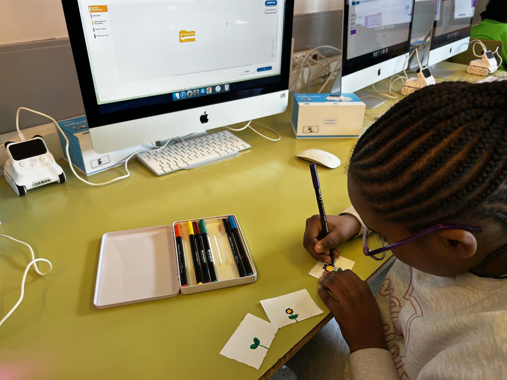
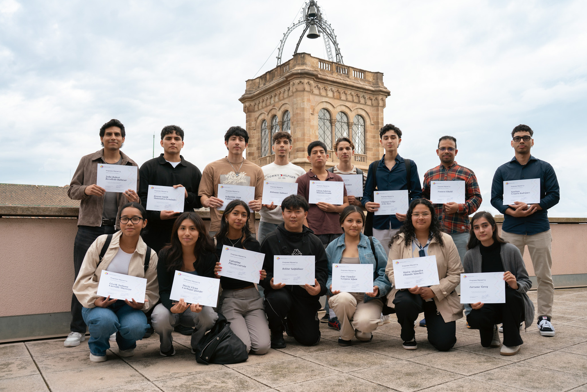
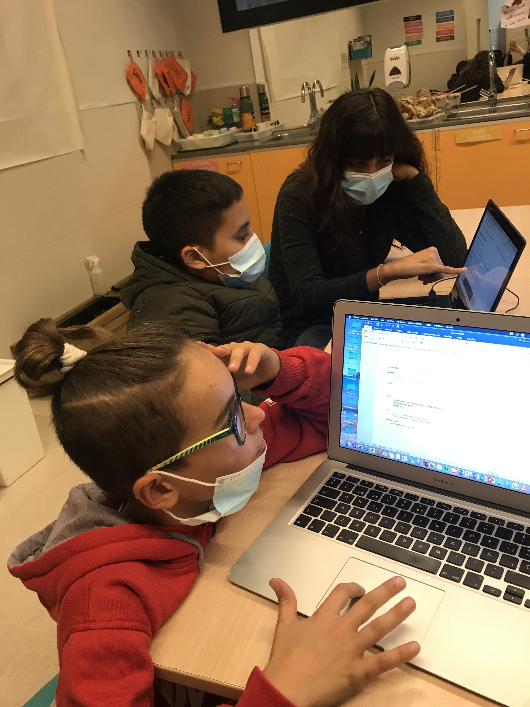
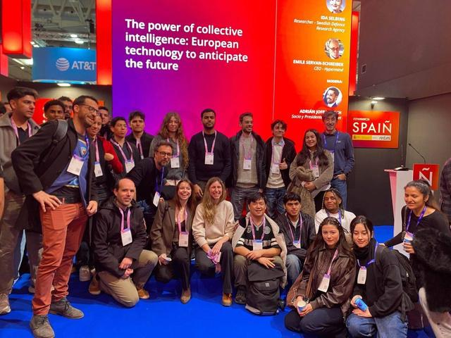
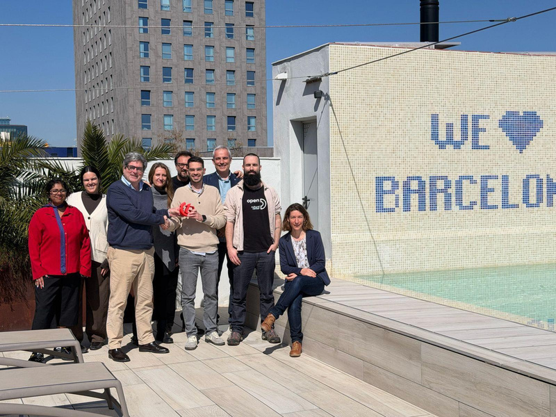

<h1>2025 in Review</h1>

	

	 <h2>Friquis Benefited</h2>
	 
???

	

	

	 <h2>FriquiFund Members</h2>
	 
171

	

	

	 <h2>Total Donations</h2>
	 

	

<h2>Collaborations</h2>

	

		
	

	

		<h3>Fundacio scientira: Girls Gem</h3>
		
Robotics for girls and boys at three underprivileged schools, reaching 217 students.

		
From the teachers:

		
“L'alumnat de 5è està molt motivat amb aquestes sessions, ja que no només han pogut seguir les indicacions de la plataforma, sinó que també han tingut l'oportunitat de crear i construir els seus propis projectes. Aquest enfocament pràctic els permet veure els resultats de la seva feina de manera immediata, el que genera una gran satisfacció i afavoreix l'aprenentatge actiu”.

	

	

		
	

	

		<h3>Barcelona Actua: Migrant Up & U-Bac</h3>
		
Scholarship that cover tuition and mentorship so students can continue studying, to which FF was able to contribute ?? €.

	

	

		
	

	

		<h3>IRES: Click grants</h3>
		
This program aims to supports young people who wish to continue with post-compulsory studies in STEM fields with individualised mentoring, tuition grants and other economic necessities. We were able to fund the grants for five students. Furthermore, FriquiFund members have the opportunity to provide mentoring to the young people, sharing their know-how and experience.

		
From a student: <em>“Per a mi el Click és més que una oportunitat, és el camí que em porta a complir els meus somnis.”</em>

	

	

		
	

	

		<h3>Explorium </h3>
		
Our funding supported extracurricular science and technology programs in high-complexity public school so that STEM can be part of students’ lives year round. We were also able to fund scholarships for 5 students to attend immersive summer camps.

		
From the program: <em>“Han pogut viure activitats STEM des de l’hora de llevar-se fins a l’hora d’anar a dormir rodejats d’altres infants i joves amb qui comparteixen la passió per la ciència, les matemàtiques i la tecnologia. […] Tots ells i elles han mostrat moltíssima motivació i han après molt. Sabem que ho han gaudit perquè quan els ho proposem, volen tornar a venir.”</em>

	

	

		
	

	

		<h3>AEI Raval </h3>
		
Our members donated laptops, enabling students to access technological tools and learning opportunities. For this campaign we collected used laptops, inspected them and refurbished them for students in need. We were also able to provide additional funds toward the purchase of IT equipment to assist young people with their studies.

	

	

		
	

	

		<h3>MigraCode JobBuddies</h3>
		
We continued our JobBuddies collaboration with Migracode, in which we provide direct mentorship to students looking to land their first job in tech. It spans 8 weeks with one-hour session each week, providing structured assistance to find a job and covering topics such as CV preparation, job search techniques, crafting cover letters, interview readiness and mock interviews.

		
From a mentee: <em>“I really enjoyed the program, and with the mentor I was assigned, I felt very guided and supported. […] If I had to choose one part that helped me the most, it would be improving my CV—I felt it was something I had overlooked and really needed to work on. I’m continuing to apply and look for opportunities, and I’m excited to take the next step in my career!"</em>

		
From a FriquiFund mentor: <em>“Mentoring with JobBuddies has been a really meaningful experience. The best part is watching mentees shift from uncertainty to confidence—understanding what that job offer is actually asking for, why they’re a fit, and how to show it. If you’ve worked in tech or hired for tech roles, your perspective is exactly what first‑time applicants need.”</em>

	

<h2>Events</h2>

	

		
	

	

		<h3>Mobile World Congress visit</h3>
		
We returned to MWC in 2025! A group of FriquiFund members, and some 30 students from Barcelona Actua, Fundació IRES, and Prometheus enjoyed a guided tour and were able to take advantage of the opportunity.

	

	

		
	

	

		<h3>Tech Heroes</h3>
		
Last May we held the "Tech Heroes" event at CosmoCaixa. This initiative is primarily designed for girls in secondary education (ESO) attending schools in highly complex environments. It offers an opportunity to explore STEM fields through engagement with role models in these sectors. The event involves spending a day at CosmoCaixa, listening to talks by female experts in AI, robotics, technology, and science, with the aim of showing the students that these disciplines are for them too.

	

	

		
	

	

		<h3>Premi Talent</h3>
		
The Friqufund & Migracode Collaboration was recognized with the Talent Award 2025 in the category of SDG, Equality and Solidarity. Presented by the Fundació Impulsa Talentum, this prestigious recognition celebrates the success of the Job Buddies mentoring program. This recognition highlights the joint effort and impact of the Project in advancing inclusion and equal opportunities within the tech sector. The award ceremony also provided a platform to further showcase and amplify the work carried out through this partnership.

	

